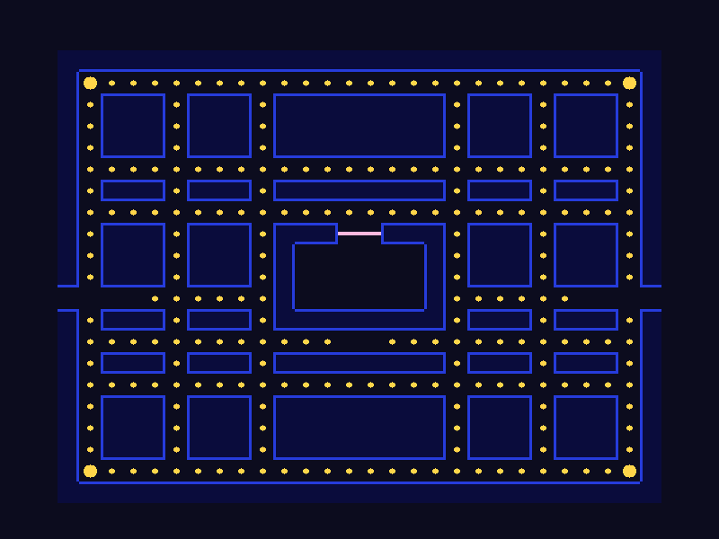

# Chapter 2: Drawing the Maze

!!! abstract "Chapter goal"
    Turn the empty window into a 28 × 21 tile maze: continuous blue walls, a field of pellets, four power pellets, and a ghost-house door. Pac-Man cannot move yet. This chapter builds the board he will move around in.

*The actual output of the program at the end of this chapter. Every wall, pellet, and door is drawn with SDL3 primitives.*

Chapter 1 ended with a window full of background. The renderer worked, but there was nothing to see. Now we give it something to draw.

There are two jobs in this chapter:

1. Describe the maze as **data**.
2. Turn that data into **pixels**.

Keeping those jobs separate matters. The map should not care how walls are drawn, and the drawing code should not hard-code the shape of every wall. When Pac-Man starts moving in Chapter 3, the same map data will answer the question "is this tile a wall?".

## 1. A maze made of text

A Pac-Man maze is a grid of square **tiles**. Ours is 28 tiles wide and 21 tiles tall. Each tile is 24 pixels, so the maze itself is:

~~~text
28 × 24 = 672 pixels wide
21 × 24 = 504 pixels tall
~~~

The window is 800 × 600, so the maze sits at (64, 56). That leaves 64 pixels of margin on the left and right, 56 pixels above for a future HUD, and 40 pixels below.

The map is written as 21 strings. One character describes one tile:

| Character | Meaning |
| --------- | ------- |
| `#` | wall |
| `.` | pellet |
| `o` | power pellet |
| `=` | ghost-house door |
| space | empty walkable floor |

Here is the map we will use:

~~~text
############################
#o........................o#
#.###.###.########.###.###.#
#.###.###.########.###.###.#
#.###.###.########.###.###.#
#..........................#
#.###.###.########.###.###.#
#..........................#
#.###.###.###==###.###.###.#
#.###.###.#      #.###.###.#
#.###.###.#      #.###.###.#
    ......#      #......
#.###.###.########.###.###.#
#............  ............#
#.###.###.########.###.###.#
#..........................#
#.###.###.########.###.###.#
#.###.###.########.###.###.#
#.###.###.########.###.###.#
#o........................o#
############################
~~~

A few things to notice:

- The map is symmetric. The left half has a matching right half, which makes it easier to design and easier to read.
- The four `o` tiles in the corners are power pellets.
- The `=` door sits at the top of the ghost house, in the middle of the map.
- The two spaces below the house, on row 13, are where Pac-Man will start in Chapter 3.
- Row 11 has four spaces at each end. Those are the side tunnels. In this chapter they are simply gaps; later they will wrap Pac-Man and the ghosts around the screen.

!!! note "An original maze"
    This layout is original. Do not replace it with a copied arcade maze or a sprite-based map; the point of the tutorial is to build the game from scratch. The maze is also deliberately simple. It has no dead ends, which keeps the first ghost AI manageable.

The long-term advantage of storing the maze this way is that every system can query it. Drawing asks "what is at this tile?". Collision will ask "is this tile a wall?". Scoring will ask "was that a pellet?". None of those systems need to know how the maze is painted.

## 2. Adding the map and its constants

We need four new standard headers:

~~~cpp
#include <SDL3/SDL.h>

#include <array>
#include <cmath>
#include <cstddef>
#include <memory>
#include <string_view>
~~~

- `<array>` gives us a fixed-size array for the map.
- `<string_view>` lets each map row be a lightweight, read-only string.
- `<cstddef>` gives us `std::size_t` for indexing.
- `<cmath>` gives us `std::sqrt` for drawing circles.
- `<memory>` was already there for `std::unique_ptr`.

The `config` namespace now describes the board as well as the window:

~~~cpp
constexpr int kWindowWidth = 800;
constexpr int kWindowHeight = 600;
constexpr SDL_Color kBackground{12, 12, 30, 255};

constexpr int kMazeCols = 28;
constexpr int kMazeRows = 21;
constexpr float kTileSize = 24.0F;
constexpr float kMazeOriginX = 64.0F;
constexpr float kMazeOriginY = 56.0F;

constexpr SDL_Color kWallFillColor{10, 12, 60, 255};
constexpr SDL_Color kWallEdgeColor{38, 60, 220, 255};
constexpr SDL_Color kPelletColor{255, 213, 74, 255};
constexpr SDL_Color kDoorColor{255, 184, 222, 255};

constexpr float kWallThickness = 3.0F;
constexpr float kPelletRadius = 3.0F;
constexpr float kPowerPelletRadius = 7.0F;
constexpr float kDoorThickness = 4.0F;
~~~

The two palettes are worth separating. `kWallFillColor` is a dark navy that gives walls a body. `kWallEdgeColor` is the bright blue outline. If we used the same color for both, the maze would look like one flat blue mass. The pellets are gold, and the door is pink so it stands out from the walls.

The map itself is a `constexpr` array of strings:

~~~cpp
// Legend: '#' wall, '.' pellet, 'o' power pellet, '=' ghost-house door,
// ' ' empty walkable floor.
// This table is a picture; keep one maze row per line.
// clang-format off
constexpr std::array<std::string_view, kMazeRows> kMaze = {{
    "############################",
    "#o........................o#",
    "#.###.###.########.###.###.#",
    "#.###.###.########.###.###.#",
    "#.###.###.########.###.###.#",
    "#..........................#",
    "#.###.###.########.###.###.#",
    "#..........................#",
    "#.###.###.###==###.###.###.#",
    "#.###.###.#      #.###.###.#",
    "#.###.###.#      #.###.###.#",
    "    ......#      #......    ", // tunnel row: open at both edges
    "#.###.###.########.###.###.#",
    "#............  ............#", // Pac-Man will spawn here later
    "#.###.###.########.###.###.#",
    "#..........................#",
    "#.###.###.########.###.###.#",
    "#.###.###.########.###.###.#",
    "#.###.###.########.###.###.#",
    "#o........................o#",
    "############################",
}};
// clang-format on
~~~

Each row must be exactly 28 characters. If one row is short, the rest of the maze shifts sideways and reading a later column will eventually throw an exception. A long row silently changes what the drawing code sees. Count carefully.

The `// clang-format off` comment tells clang-format to leave the table alone. Without it, the formatter tries to pack several short strings onto one line and the map stops looking like a map.

!!! tip "Why not `char kMaze[21][28]`?"
    A 2D array of characters works too, but a list of strings is much easier to edit. You can see the shape of the maze in the source, copy a row, and compare rows by eye. `std::string_view` gives read-only access without copying the strings.

!!! note "What is a `string_view`?"
    A `std::string_view` is a non-owning view of a string: a pointer and a length. It does not copy the characters and it does not allocate memory. The string literals in `kMaze` live for the entire program, so a view of them is always valid here.

## 3. From tiles to pixels

Everything in the game will use two coordinate systems:

- **Tile coordinates:** integer `(col, row)`, where `(0, 0)` is the top-left tile.
- **Pixel coordinates:** floating-point `(x, y)`, where `(0, 0)` is the top-left of the window.

The conversion is simple:

~~~text
pixelX = kMazeOriginX + col * kTileSize
pixelY = kMazeOriginY + row * kTileSize
~~~

The helper functions put that formula in one place:

~~~cpp
constexpr float tileLeft(int col) {
    return config::kMazeOriginX + (static_cast<float>(col) * config::kTileSize);
}

constexpr float tileTop(int row) {
    return config::kMazeOriginY + (static_cast<float>(row) * config::kTileSize);
}

constexpr float tileCenterX(int col) {
    return tileLeft(col) + (config::kTileSize / 2.0F);
}

constexpr float tileCenterY(int row) {
    return tileTop(row) + (config::kTileSize / 2.0F);
}
~~~

For example, tile `(0, 0)` is at pixel `(64, 56)`. Its center is at `(76, 68)`. Tile `(27, 20)` is the bottom-right tile; its top-left is `(64 + 27 × 24, 56 + 20 × 24) = (712, 536)`, and it ends at `(736, 560)`. The extra margins are exactly as planned.

The `static_cast<float>(col)` is there because `col` is an integer. Multiplying an `int` by a `float` is legal, but being explicit keeps the conversion visible and keeps the compiler's `-Wconversion` warning quiet.

Now we need a way to ask what is in a tile:

~~~cpp
char tileAt(int col, int row) {
    if (col < 0 || col >= config::kMazeCols) {
        return '#';
    }
    if (row < 0 || row >= config::kMazeRows) {
        return '#';
    }
    return config::kMaze.at(static_cast<std::size_t>(row))
        .at(static_cast<std::size_t>(col));
}

bool isWall(int col, int row) { return tileAt(col, row) == '#'; }
~~~

Two decisions matter here.

First, **out-of-bounds counts as a wall**. Asking `isWall(-1, 5)` returns true, and so does `isWall(5, 999)`. That is exactly what we want when drawing wall outlines: the outside of the maze should not have a bright edge. It will also be the right default for movement later, except at the tunnels, which we will handle explicitly.

Second, the map is indexed **[row][col]**, not **[col][row]**. The row chooses the string; the column chooses the character inside it. Reversing them is one of the easiest mistakes to make, and it usually shows up as a `std::out_of_range` exception or a maze that looks scrambled.

We use `.at()` rather than `[]` because we have already checked the bounds. `.at()` documents that this is a safe lookup, and if we ever get the bounds wrong, we get an exception instead of silently reading the wrong character.

## 4. Walls that join up

The obvious way to draw a wall tile is to fill its 24 × 24 square with blue. That works, but adjacent wall tiles merge into one solid mass, and the maze becomes a blue blob with corridors cut into it. The outlines that make Pac-Man's maze readable are lost.

The opposite approach is to outline every wall tile. That draws a line between every pair of adjacent wall tiles, so a solid wall looks like a grid of little boxes. Also not what we want.

We will use a middle path:

1. Fill every wall tile with a dark blue.
2. Draw a bright edge only on the sides that face open floor.

Adjacent wall tiles do not draw a line between them, so a group of walls becomes one continuous shape. The edge algorithm is just four neighbor checks. First, a small helper saves us from constructing an `SDL_FRect` every time:

~~~cpp
void fillRect(SDL_Renderer* renderer, float x, float y, float width,
              float height) {
    const SDL_FRect rect{x, y, width, height};
    SDL_RenderFillRect(renderer, &rect);
}
~~~

SDL3's rectangle-drawing functions take a pointer to an `SDL_FRect`. The helper keeps the address lifetime obvious: the local `rect` exists for the duration of the `SDL_RenderFillRect` call.

Now the edge function:

~~~cpp
void drawWallEdges(SDL_Renderer* renderer, int col, int row) {
    const float left = tileLeft(col);
    const float top = tileTop(row);

    if (!isWall(col, row - 1)) {
        fillRect(renderer, left, top, config::kTileSize,
                 config::kWallThickness);
    }
    if (!isWall(col, row + 1)) {
        fillRect(renderer, left,
                 top + config::kTileSize - config::kWallThickness,
                 config::kTileSize, config::kWallThickness);
    }
    if (!isWall(col - 1, row)) {
        fillRect(renderer, left, top, config::kWallThickness,
                 config::kTileSize);
    }
    if (!isWall(col + 1, row)) {
        fillRect(renderer, left + config::kTileSize - config::kWallThickness,
                 top, config::kWallThickness, config::kTileSize);
    }
}
~~~

Read the four conditions as:

- If the tile above is not a wall, draw a horizontal edge across the top.
- If the tile below is not a wall, draw a horizontal edge across the bottom.
- If the tile to the left is not a wall, draw a vertical edge on the left.
- If the tile to the right is not a wall, draw a vertical edge on the right.

Because out-of-bounds counts as a wall, the outer border has no bright outside edge. The dark fill still defines the maze's outer shape.

Now the wall passes inside `drawMaze`:

~~~cpp
    // First, fill every wall tile. This gives the maze a solid body.
    SDL_SetRenderDrawColor(renderer, config::kWallFillColor.r,
                           config::kWallFillColor.g, config::kWallFillColor.b,
                           config::kWallFillColor.a);
    for (int row = 0; row < config::kMazeRows; ++row) {
        for (int col = 0; col < config::kMazeCols; ++col) {
            if (isWall(col, row)) {
                fillRect(renderer, tileLeft(col), tileTop(row),
                         config::kTileSize, config::kTileSize);
            }
        }
    }

    // Then outline only the wall edges that face open floor.
    SDL_SetRenderDrawColor(renderer, config::kWallEdgeColor.r,
                           config::kWallEdgeColor.g, config::kWallEdgeColor.b,
                           config::kWallEdgeColor.a);
    for (int row = 0; row < config::kMazeRows; ++row) {
        for (int col = 0; col < config::kMazeCols; ++col) {
            if (isWall(col, row)) {
                drawWallEdges(renderer, col, row);
            }
        }
    }
~~~

Why two passes? The first pass paints every wall. The second pass paints bright lines on top. If we tried to do both in one pass, later wall fills could paint over earlier edges. Keeping the passes separate also makes the code easier to reason about.

## 5. Pellets without a circle primitive

SDL's renderer gives us rectangles and lines. It does not give us a "fill circle" function. That is not a problem: a circle is just a stack of horizontal lines of different lengths.

For a circle centered at `(cx, cy)` with radius `r`, a line at vertical offset `dy` needs to extend from `cx - halfWidth` to `cx + halfWidth`, where:

~~~text
halfWidth = sqrt(r² - dy²)
~~~

At `dy = 0` the line is the full diameter. At `dy = r` the line has zero length. In between, it shrinks smoothly. Here is the helper:

~~~cpp
void drawFilledCircle(SDL_Renderer* renderer, float centerX, float centerY,
                      float radius) {
    const int radiusPixels = static_cast<int>(radius);
    for (int offset = -radiusPixels; offset <= radiusPixels; ++offset) {
        const float dy = static_cast<float>(offset);
        const float halfWidth = std::sqrt((radius * radius) - (dy * dy));
        SDL_RenderLine(renderer, centerX - halfWidth, centerY + dy,
                       centerX + halfWidth, centerY + dy);
    }
}
~~~

A pellet has radius 3, so it is built from seven horizontal lines. A power pellet has radius 7, so it gets fifteen lines and looks noticeably bigger. At 60 frames per second this is plenty fast.

The same function will draw Pac-Man's body in Chapter 3, and the ghosts' rounded heads after that. It is worth understanding now.

Drawing the two pellet sizes is one pass over the map:

~~~cpp
    // Pellets.
    SDL_SetRenderDrawColor(renderer, config::kPelletColor.r,
                           config::kPelletColor.g, config::kPelletColor.b,
                           config::kPelletColor.a);
    for (int row = 0; row < config::kMazeRows; ++row) {
        for (int col = 0; col < config::kMazeCols; ++col) {
            if (tileAt(col, row) == '.') {
                drawFilledCircle(renderer, tileCenterX(col), tileCenterY(row),
                                 config::kPelletRadius);
            } else if (tileAt(col, row) == 'o') {
                drawFilledCircle(renderer, tileCenterX(col), tileCenterY(row),
                                 config::kPowerPelletRadius);
            }
        }
    }
~~~

The current draw color is part of the renderer state, not a parameter of `drawFilledCircle`. That is why we set the gold color once before the loop, and why every line inside the helper uses gold.

## 6. The ghost-house door

The door is a thin pink bar, not a wall. It marks the only place where ghosts will be allowed to leave their house. For now, it is purely visual.

~~~cpp
    // Ghost-house door.
    SDL_SetRenderDrawColor(renderer, config::kDoorColor.r, config::kDoorColor.g,
                           config::kDoorColor.b, config::kDoorColor.a);
    for (int row = 0; row < config::kMazeRows; ++row) {
        for (int col = 0; col < config::kMazeCols; ++col) {
            if (tileAt(col, row) == '=') {
                fillRect(renderer, tileLeft(col),
                         tileTop(row) + (config::kTileSize / 2.0F) -
                             (config::kDoorThickness / 2.0F),
                         config::kTileSize, config::kDoorThickness);
            }
        }
    }
~~~

The vertical position is the tile's top plus half a tile, minus half the door thickness. That centers the bar vertically inside the tile. Each of the two `=` tiles draws its own segment, and together they form one continuous door.

The order of drawing matters here. Walls are drawn first, then pellets, then the door. If the door were drawn before the wall fill, the fill could cover it. We have not placed the door next to a filled tile in a way that overlaps, but keeping a deliberate order avoids surprises when the maze changes.

## 7. Wiring it into the loop

The complete `drawMaze` function is a sequence of the pieces above:

~~~text
void drawMaze(SDL_Renderer* renderer) {
    fill walls
    outline walls
    draw pellets and power pellets
    draw the door
}
~~~

We are deliberately not repeating the full body here; it is in the complete listing below. The important integration point is in `main`. Chapter 1's loop only cleared the background. Now it clears the background and calls `drawMaze` before presenting:

~~~cpp
        SDL_SetRenderDrawColor(renderer.get(), config::kBackground.r,
                               config::kBackground.g, config::kBackground.b,
                               config::kBackground.a);
        SDL_RenderClear(renderer.get());
        drawMaze(renderer.get());
        SDL_RenderPresent(renderer.get());
~~~

`drawMaze` does not clear the screen. Clearing is the loop's job, and drawing is the maze's job. Keeping those responsibilities separate makes it easy to add a HUD later: the loop clears, draws the maze, draws Pac-Man and the ghosts, draws the HUD, and finally presents.

## 8. The complete file

Here is the entire `main.cpp` after this chapter. It is longer than Chapter 1 because the map is part of the source. The SDL lifetime and loop code are unchanged.

~~~cpp
// Pac-Man tutorial - Chapter 2: drawing the maze.

#include <SDL3/SDL.h>

#include <array>
#include <cmath>
#include <cstddef>
#include <memory>
#include <string_view>

// ---------------------------------------------------------------------------
// Configuration
// ---------------------------------------------------------------------------

namespace config {
constexpr int kWindowWidth = 800;
constexpr int kWindowHeight = 600;
constexpr SDL_Color kBackground{12, 12, 30, 255};

constexpr int kMazeCols = 28;
constexpr int kMazeRows = 21;
constexpr float kTileSize = 24.0F;
constexpr float kMazeOriginX = 64.0F;
constexpr float kMazeOriginY = 56.0F;

constexpr SDL_Color kWallFillColor{10, 12, 60, 255};
constexpr SDL_Color kWallEdgeColor{38, 60, 220, 255};
constexpr SDL_Color kPelletColor{255, 213, 74, 255};
constexpr SDL_Color kDoorColor{255, 184, 222, 255};

constexpr float kWallThickness = 3.0F;
constexpr float kPelletRadius = 3.0F;
constexpr float kPowerPelletRadius = 7.0F;
constexpr float kDoorThickness = 4.0F;

// Legend: '#' wall, '.' pellet, 'o' power pellet, '=' ghost-house door,
// ' ' empty walkable floor.
// This table is a picture; keep one maze row per line.
// clang-format off
constexpr std::array<std::string_view, kMazeRows> kMaze = {{
    "############################",
    "#o........................o#",
    "#.###.###.########.###.###.#",
    "#.###.###.########.###.###.#",
    "#.###.###.########.###.###.#",
    "#..........................#",
    "#.###.###.########.###.###.#",
    "#..........................#",
    "#.###.###.###==###.###.###.#",
    "#.###.###.#      #.###.###.#",
    "#.###.###.#      #.###.###.#",
    "    ......#      #......    ", // tunnel row: open at both edges
    "#.###.###.########.###.###.#",
    "#............  ............#", // Pac-Man will spawn here later
    "#.###.###.########.###.###.#",
    "#..........................#",
    "#.###.###.########.###.###.#",
    "#.###.###.########.###.###.#",
    "#.###.###.########.###.###.#",
    "#o........................o#",
    "############################",
}};
// clang-format on
} // namespace config

namespace {

// ---------------------------------------------------------------------------
// SDL lifetime
// ---------------------------------------------------------------------------

// Shut down SDL when this object goes out of scope.
class SdlGuard {
  public:
    SdlGuard() : initialized_(SDL_Init(SDL_INIT_VIDEO)) {
        if (!initialized_) {
            SDL_Log("SDL_Init failed: %s", SDL_GetError());
        }
    }

    ~SdlGuard() {
        if (initialized_) {
            SDL_Quit();
        }
    }

    SdlGuard(const SdlGuard&) = delete;
    SdlGuard& operator=(const SdlGuard&) = delete;
    SdlGuard(SdlGuard&&) = delete;
    SdlGuard& operator=(SdlGuard&&) = delete;

    [[nodiscard]] bool initialized() const { return initialized_; }

  private:
    bool initialized_ = false;
};

struct WindowDeleter {
    void operator()(SDL_Window* window) const { SDL_DestroyWindow(window); }
};

struct RendererDeleter {
    void operator()(SDL_Renderer* renderer) const {
        SDL_DestroyRenderer(renderer);
    }
};

using WindowPtr = std::unique_ptr<SDL_Window, WindowDeleter>;
using RendererPtr = std::unique_ptr<SDL_Renderer, RendererDeleter>;

// ---------------------------------------------------------------------------
// Tile coordinates
// ---------------------------------------------------------------------------

constexpr float tileLeft(int col) {
    return config::kMazeOriginX + (static_cast<float>(col) * config::kTileSize);
}

constexpr float tileTop(int row) {
    return config::kMazeOriginY + (static_cast<float>(row) * config::kTileSize);
}

constexpr float tileCenterX(int col) {
    return tileLeft(col) + (config::kTileSize / 2.0F);
}

constexpr float tileCenterY(int row) {
    return tileTop(row) + (config::kTileSize / 2.0F);
}

char tileAt(int col, int row) {
    if (col < 0 || col >= config::kMazeCols) {
        return '#';
    }
    if (row < 0 || row >= config::kMazeRows) {
        return '#';
    }
    return config::kMaze.at(static_cast<std::size_t>(row))
        .at(static_cast<std::size_t>(col));
}

bool isWall(int col, int row) { return tileAt(col, row) == '#'; }

// ---------------------------------------------------------------------------
// Drawing helpers
// ---------------------------------------------------------------------------

void fillRect(SDL_Renderer* renderer, float x, float y, float width,
              float height) {
    const SDL_FRect rect{x, y, width, height};
    SDL_RenderFillRect(renderer, &rect);
}

void drawFilledCircle(SDL_Renderer* renderer, float centerX, float centerY,
                      float radius) {
    const int radiusPixels = static_cast<int>(radius);
    for (int offset = -radiusPixels; offset <= radiusPixels; ++offset) {
        const float dy = static_cast<float>(offset);
        const float halfWidth = std::sqrt((radius * radius) - (dy * dy));
        SDL_RenderLine(renderer, centerX - halfWidth, centerY + dy,
                       centerX + halfWidth, centerY + dy);
    }
}

void drawWallEdges(SDL_Renderer* renderer, int col, int row) {
    const float left = tileLeft(col);
    const float top = tileTop(row);

    if (!isWall(col, row - 1)) {
        fillRect(renderer, left, top, config::kTileSize,
                 config::kWallThickness);
    }
    if (!isWall(col, row + 1)) {
        fillRect(renderer, left,
                 top + config::kTileSize - config::kWallThickness,
                 config::kTileSize, config::kWallThickness);
    }
    if (!isWall(col - 1, row)) {
        fillRect(renderer, left, top, config::kWallThickness,
                 config::kTileSize);
    }
    if (!isWall(col + 1, row)) {
        fillRect(renderer, left + config::kTileSize - config::kWallThickness,
                 top, config::kWallThickness, config::kTileSize);
    }
}

void drawMaze(SDL_Renderer* renderer) {
    // First, fill every wall tile. This gives the maze a solid body.
    SDL_SetRenderDrawColor(renderer, config::kWallFillColor.r,
                           config::kWallFillColor.g, config::kWallFillColor.b,
                           config::kWallFillColor.a);
    for (int row = 0; row < config::kMazeRows; ++row) {
        for (int col = 0; col < config::kMazeCols; ++col) {
            if (isWall(col, row)) {
                fillRect(renderer, tileLeft(col), tileTop(row),
                         config::kTileSize, config::kTileSize);
            }
        }
    }

    // Then outline only the wall edges that face open floor.
    SDL_SetRenderDrawColor(renderer, config::kWallEdgeColor.r,
                           config::kWallEdgeColor.g, config::kWallEdgeColor.b,
                           config::kWallEdgeColor.a);
    for (int row = 0; row < config::kMazeRows; ++row) {
        for (int col = 0; col < config::kMazeCols; ++col) {
            if (isWall(col, row)) {
                drawWallEdges(renderer, col, row);
            }
        }
    }

    // Pellets.
    SDL_SetRenderDrawColor(renderer, config::kPelletColor.r,
                           config::kPelletColor.g, config::kPelletColor.b,
                           config::kPelletColor.a);
    for (int row = 0; row < config::kMazeRows; ++row) {
        for (int col = 0; col < config::kMazeCols; ++col) {
            if (tileAt(col, row) == '.') {
                drawFilledCircle(renderer, tileCenterX(col), tileCenterY(row),
                                 config::kPelletRadius);
            } else if (tileAt(col, row) == 'o') {
                drawFilledCircle(renderer, tileCenterX(col), tileCenterY(row),
                                 config::kPowerPelletRadius);
            }
        }
    }

    // Ghost-house door.
    SDL_SetRenderDrawColor(renderer, config::kDoorColor.r, config::kDoorColor.g,
                           config::kDoorColor.b, config::kDoorColor.a);
    for (int row = 0; row < config::kMazeRows; ++row) {
        for (int col = 0; col < config::kMazeCols; ++col) {
            if (tileAt(col, row) == '=') {
                fillRect(renderer, tileLeft(col),
                         tileTop(row) + (config::kTileSize / 2.0F) -
                             (config::kDoorThickness / 2.0F),
                         config::kTileSize, config::kDoorThickness);
            }
        }
    }
}

} // namespace

int main() {
    SdlGuard sdl;
    if (!sdl.initialized()) {
        return 1;
    }

    WindowPtr window{SDL_CreateWindow("Pac-Man", config::kWindowWidth,
                                      config::kWindowHeight, 0)};
    if (!window) {
        SDL_Log("SDL_CreateWindow failed: %s", SDL_GetError());
        return 1;
    }

    RendererPtr renderer{SDL_CreateRenderer(window.get(), nullptr)};
    if (!renderer) {
        SDL_Log("SDL_CreateRenderer failed: %s", SDL_GetError());
        return 1;
    }

    if (!SDL_SetRenderVSync(renderer.get(), 1)) {
        SDL_Log("VSync unavailable: %s", SDL_GetError());
    }

    bool running = true;
    SDL_Event event{};

    while (running) {
        while (SDL_PollEvent(&event)) {
            if (event.type == SDL_EVENT_QUIT) {
                running = false;
            } else if (event.type == SDL_EVENT_KEY_DOWN &&
                       event.key.key == SDLK_ESCAPE) {
                running = false;
            }
        }

        SDL_SetRenderDrawColor(renderer.get(), config::kBackground.r,
                               config::kBackground.g, config::kBackground.b,
                               config::kBackground.a);
        SDL_RenderClear(renderer.get());
        drawMaze(renderer.get());
        SDL_RenderPresent(renderer.get());
    }

    return 0;
}
~~~

## 9. Build and run

From the repository root, with the `pacman` target from Chapter 1 still in place:

~~~bash
cmake --build build --target pacman
./build/pacman
~~~

If you have not configured since adding the target, run `cmake -B build` first. Expect the maze to appear over the dark background, with gold pellets, four large power pellets, continuous blue walls, and a small pink door at the top of the central ghost house.

Try resizing the window? Do not bother yet; the game uses fixed pixel coordinates. Press Esc or close the window when you are done.

If the maze is shifted or a row looks misaligned, the most likely cause is a row in `kMaze` that is not exactly 28 characters. Count the row, fix it, and rebuild. The compiler cannot see the shape of a maze inside a string.

## 10. When it does not work

| Symptom | Likely cause | What to try |
| ------- | ------------ | ----------- |
| The program crashes in `tileAt` with `std::out_of_range` | A map row is shorter than expected, or column and row are swapped | Count every row; check that the row index selects the string and the column index selects the character |
| The maze is shifted sideways | A row is not 28 characters, or the origin constants were edited | Count rows; confirm `kMazeOriginX` and `kTileSize` |
| Only the background appears | `drawMaze` is not called, or it returns early | Check the loop: clear, `drawMaze`, present |
| Walls look like separate boxes | You are outlining every tile or filling edges differently | Compare `drawWallEdges` with the listing; only edges facing floor are drawn |
| No pellets appear | The map uses spaces instead of `.`, or the pellet loop is missing | Check the legend and the pellet pass |
| The power pellets look the same as normal pellets | Both calls use `kPelletRadius` | Use `kPowerPelletRadius` for `o` |
| The door is invisible | It is drawn before the wall fill, or the color is too close to the background | Draw it last; keep the pink color |
| The tunnel openings are closed | The leading or trailing spaces in row 11 were trimmed | Put the four spaces back at each end of the row |
| clang-format packed several map rows onto one line | The `clang-format off` comments were removed | Restore the comment immediately before `kMaze` and the one immediately after it |

## 11. Exercises

1. **Repaint the maze.** Change `kWallFillColor` and `kWallEdgeColor`. Try a green maze, a purple maze, and a monochrome maze. Keep the pellets readable against the walls.
2. **Change the pellet sizes.** Set `kPelletRadius` to 4 and `kPowerPelletRadius` to 8. Rebuild. Do the pellets still fit inside their tiles?
3. **Move a wall.** Turn one `#` tile into a `.` pellet and one nearby `.` into a `#` wall. Watch the outlines around the changed tiles update. This is the fastest way to see how the edge algorithm responds to its neighbors.
4. **Open the tunnels.** The map already has four spaces at each end of row 11. Change them to `.` pellets and rebuild. The maze looks different, but the future tunnel logic will still depend on the map's open edge, not on the absence of pellets.
5. **Count the dots.** Write a small loop that counts every `.` and `o` in `kMaze` and logs the totals with `SDL_Log` at startup. You will need these counts in Chapter 4 to decide when the player has won.
6. **Draw a placeholder Pac-Man.** In the drawing loop, after `drawMaze`, call `drawFilledCircle` at the center of tile `(13, 13)` with radius 9 and yellow. The two spaces below the house are Pac-Man's spawn. He will not move yet; this is a preview of Chapter 3.

??? example "One possible solution to exercise 5"
    Add a counting pass in `main`, once, before the game loop:

    ~~~cpp
    int pellets = 0;
    int powerPellets = 0;
    for (int row = 0; row < config::kMazeRows; ++row) {
        for (int col = 0; col < config::kMazeCols; ++col) {
            if (tileAt(col, row) == '.') {
                ++pellets;
            } else if (tileAt(col, row) == 'o') {
                ++powerPellets;
            }
        }
    }
    SDL_Log("Pellets: %d, power pellets: %d", pellets, powerPellets);
    ~~~

    The exact totals are not important; the code is a rehearsal for the win condition.

??? example "One possible solution to exercise 6"
    After `drawMaze(renderer.get())` in the loop:

    ~~~cpp
    SDL_SetRenderDrawColor(renderer.get(), 255, 213, 74, 255);
    drawFilledCircle(renderer.get(), tileCenterX(13), tileCenterY(13), 9.0F);
    ~~~

    A radius of 9 fits comfortably inside a 24-pixel tile. The mouth and animation come next.

## 12. Checkpoint

- [ ] The program builds with no errors or warnings.
- [ ] The maze appears at the planned position and size.
- [ ] Walls are continuous shapes, not a grid of separate boxes.
- [ ] Pellets fill the corridors; the four corner power pellets are larger.
- [ ] The pink ghost-house door is visible at the top of the central house.
- [ ] The side-tunnel openings in row 11 are open, not walled off.
- [ ] Esc and the window close button still exit cleanly.
- [ ] You can point at a map character and say which pixel rectangle it becomes.

## 13. Recap

In this chapter you:

- Represented the maze as 21 strings of 28 characters, with a small legend for walls, pellets, power pellets, a door, and empty floor.
- Converted tile coordinates to pixel coordinates with `tileLeft`, `tileTop`, `tileCenterX`, and `tileCenterY`.
- Wrote `tileAt` and `isWall`, including the out-of-bounds rule that treats the world outside the maze as solid.
- Drew walls in two passes: a dark fill for the wall bodies, then bright edges only where a wall meets open floor.
- Drew circles without a circle primitive by stacking horizontal lines of varying widths.
- Added the ghost-house door and wired `drawMaze` into the render loop.

The maze is now a usable, queryable world. In Chapter 3, Pac-Man will finally move through it, and `isWall` will become the collision system.

## 14. What's next

**Chapter 3: Pac-Man Moves** adds the player character:

- a Pac-Man position in tile coordinates;
- arrow-key and WASD input, with a buffered direction;
- smooth grid-step movement and wall collision;
- side-tunnel wrapping;
- an animated mouth.

We will reuse the map, the coordinate helpers, and the circle helper from this chapter. No drawing code should need to be thrown away.
