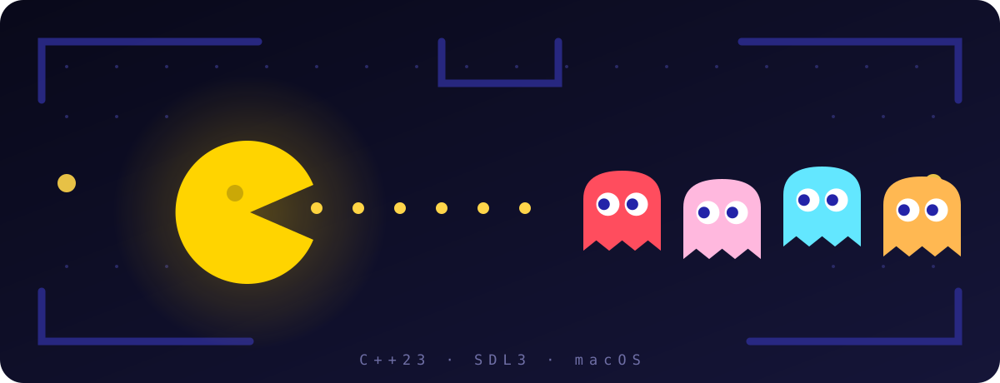

# Build Pac-Man from Scratch

*An illustration of the finish line. The real game is drawn from plain SDL shapes.*

**A hands-on tutorial for C++23 and SDL3 on macOS. Start with an empty file; finish with a playable game.**

Pac-Man is a deceptively good first game project. The rules fit on the back of a napkin, but underneath the game has everything a real one needs: a game loop, input, collision, game state, a little artificial intelligence, and a reason to win.

By the end of this tutorial you will have written a complete, playable Pac-Man clone. No game engine. No sprite sheets. No framework beyond SDL3. Just C++23 and a few hundred lines of code that you understand line by line.

[Start Chapter 1](01-window.md){ .md-button .md-button--primary }

## What you'll build

A small but complete take on Pac-Man:

- **A maze** built from a text map and drawn with simple shapes.
- **Pac-Man** who moves smoothly, turns corners, wraps through side tunnels, and chomps as he goes.
- **Four ghosts** with the classic scatter, chase, and frightened behaviors.
- **Pellets and power pellets**, a score, three lives, and points for each ghost you eat.
- **Win and lose states**, plus the ability to start again.
- **Zero asset files.** Every wall, character, and pellet is drawn with SDL3 primitives.

"Minimal" is doing some work in that list. This is one level, one maze, and a single player character. There is no fruit, no sound, no animated attract screen, and no persistent high-score table. Those are good next projects, and the final chapter points you toward them.

## Who this is for

This tutorial is for you if:

- You have written short C++ programs before. Variables, functions, loops, classes, and `std::vector` should not be new ideas.
- You have **not** necessarily used SDL3, CMake, or a game loop.
- You are on macOS and comfortable running commands in a terminal.
- You want to understand the code, not just paste it and see a window.

If you are completely new to programming, this is not the right first tutorial. Learn a little C++ first, then come back. The good news is that you do not need any game development experience at all. Chapter 1 also introduces a few modern C++ tools — RAII and smart pointers — slowly and with examples, so you do not need to have used them before.

The tutorial lives inside the cppgamearch repository and uses its build setup. Every path is relative to the repository root. If you are reading this somewhere else, the code is still portable, but the build commands assume this project layout.

## How to use this tutorial

The chapters are cumulative. Chapter 2 starts from the window you build in Chapter 1, Chapter 3 starts from the maze you build in Chapter 2, and so on. **Every chapter ends with a program that builds and runs.**

A good loop for each chapter:

1. Read the chapter goal so you know where you are going.
2. Type the new code instead of pasting it. Typing forces you to notice details.
3. Build, run, and check the chapter's checkpoint before moving on.
4. Try at least one exercise. Breaking things on purpose is part of learning.
5. Read the recap, then continue.

The complete code for each chapter is printed in the chapter itself. This repository deliberately does not include a finished `apps/pacman/main.cpp`: you create that file in Chapter 1 and extend it from there. If your program will not behave and the difference is not obvious, compare it with the complete listing at the end of the chapter.

!!! note "You write the code"
    There is no finished source file in this repository to copy from. Chapter 1 creates `apps/pacman/main.cpp` and adds the CMake target; each later chapter modifies that file. Typing the changes is part of the exercise, and every chapter prints the full file so you never have to guess what it should look like.

!!! tip "One file, on purpose"
    The whole game stays in a single `main.cpp` for the entire tutorial. That is unusual for a large project, but it keeps every piece of the game visible while you are learning. The final chapter discusses how to split it up when you are ready.

## Roadmap

| # | Chapter | You build | Main ideas |
| - | ------- | --------- | ---------- |
| — | **Introduction** *(you are here)* | A map of the journey | What the game will be, and how to learn from it |
| 1 | **[A Window Into the Maze](01-window.md)** | A window that opens and closes cleanly | SDL3, CMake, the game loop, RAII |
| 2 | Drawing the Maze | The maze, walls, and pellets | Text maps, tile grids, coordinate math |
| 3 | Pac-Man Moves | A controllable Pac-Man | Input, delta time, collision, tunnels |
| 4 | Pellets and Score | Eating, scoring, and a win condition | State, counters, on-screen text |
| 5 | Four Ghosts | A ghost house and four residents | Entities, spawning, movement |
| 6 | Ghost Personalities | Chase and scatter behavior | Targeting, distance, mode timers |
| 7 | Danger and Lives | Power pellets, frightened ghosts, death | Collision, timers, respawn |
| 8 | The Complete Game | Ready, game over, win, restart | A full game state machine |
| 9 | Beyond the Maze | Ideas for your next version | Fruit, sound, levels, refactoring |

Chapters are linked here as they are published. The plan is complete; the writing is in progress. Chapter 1 is ready now.

## The shape of the finished game

There is no engine and no scene graph. The game is a loop with a handful of small systems:

~~~text
main
 └── game loop (once per frame)
      ├── handle input       keyboard → direction
      ├── update world       move Pac-Man and ghosts, eat pellets
      ├── resolve collisions pellets, ghosts, lives
      ├── draw               maze, characters, HUD
      └── present            show the finished frame
~~~

Each chapter adds one box to that diagram. By Chapter 8, all of them work together.

## Before you start

You will need:

- macOS with [Homebrew](https://brew.sh/).
- Homebrew LLVM, CMake, and SDL3.
- A terminal, and the ability to run `cmake` and `./build/pacman`.

Chapter 1 installs and verifies everything. If you want to get a head start, the short version is:

~~~bash
brew install llvm cmake sdl3 pkg-config
~~~

!!! note "A note on Pac-Man"
    Pac-Man is a trademark of Bandai Namco Entertainment. This is a non-commercial, educational fan project. The maze layout and the art in this tutorial are original, and the code is written from scratch. Do not sell your version or pass it off as an official Pac-Man game.

Ready? Let's open a window.

[Start Chapter 1: A Window Into the Maze](01-window.md){ .md-button .md-button--primary }
